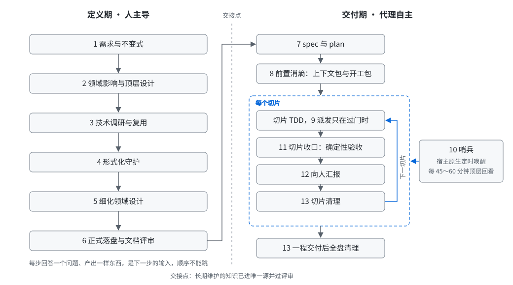

# pqw-skills

[](./LICENSE)
[](./CHANGELOG.md)
[](#skills)
[](#install)
[](./README.md)

[中文](./README.md)

A single-session development flow distilled from working with Claude Code, Codex, Cursor and other coding agents. It is a control loop: remove as much uncertainty as possible before any code is written, hand execution to the agent, then look back from the top at a fixed cadence. Human attention goes into defining boundaries and making high-level judgments, not into watching the implementation line by line.

The repository is flat: one entry skill, plus one skill per stage of the definition period and the delivery period, loaded on demand. Stages with custom methods have their text here. Stages that already have a mature method reference skills from pstack, ub-mode and mattpocock/skills instead of copying them.

The skill text is written in Chinese. This page is the English guide to what the flow is, what each skill does and how to install the set. The skill files themselves are the source of truth.

## When to use it

The flow exists for large changes only. The criterion is blast radius: use it when a change touches domain boundaries, cross-domain collaboration or the global architecture of a system.

| Use the flow | Do not use the flow |
| --- | --- |
| Adding a domain to a complex system | A small bug fix |
| Delivering a feature that cuts vertically through several domains | A quick prototype to test an idea |
| Refactoring a subsystem | A small incremental interface, designed and implemented |
| A large-scale transformation | A local change whose impact is obvious at a glance |

Work that does not qualify skips the whole flow. There is no reduced version. Such work goes straight to its own skill.

## Shape of the flow



The definition period is human-led. Each step answers one question, produces one artifact, and that artifact is the input to the next step. The order cannot be skipped. The handoff point is a physical condition: a boundary that has not reached the single source of truth and has not passed review is not defined. Once the handoff point is reached, the human can turn their attention away and the main agent drives delivery, either hands-on or as an orchestrator.

## Skills

### Entry

- **[single-session-dev-flow](./skills/single-session-dev-flow/SKILL.md)**: decides whether the work qualifies, sets the stages, their order and the handoff point, and names the skill to load at each stage. It writes the 13 stages into the session task list and contains no stage method. References in-your-own-words, poteto-mode and tdd; routes unqualified work to prototype or diagnosing-bugs.
- **[teach-pqw-skills](./skills/teach-pqw-skills/SKILL.md)**: teaches a person how to use the flow. Mental models and philosophy, what the human and the agent each do at every stage, how to write the first prompt, how to steer a run that drifted, how to wire the flow into a project. Answers and gives an example prompt; never starts the work.

### Definition period, human-led

| Step | Skill | Question it answers | References |
| --- | --- | --- | --- |
| 1 | [requirement-and-invariants](./skills/requirement-and-invariants/SKILL.md) | What capability does the user get, how does the system differ before and after, what must the system always preserve | in-your-own-words, grilling |
| 2 | [domain-impact-analysis](./skills/domain-impact-analysis/SKILL.md) | Which domains are affected, is a new domain needed, which are primary and which are incidental, how does the whole fit together | domain-modeling, principle-model-the-domain, blast-radius |
| 3 | [tech-research-and-reuse](./skills/tech-research-and-reuse/SKILL.md) | Is there a library, a similar system or a community implementation to reuse, and what is the argument for building our own | research, principle-subtract-before-you-add |
| 4 | [formal-guard](./skills/formal-guard/SKILL.md) | Which properties cannot be guarded by tests and need partial-function totalization, mathematical modeling and proof | create-formal-verification-skill, statechart, maintain-formal-verification-skill |
| 5 | [detailed-domain-design](./skills/detailed-domain-design/SKILL.md) | What do the objects, relations and repositories inside the domain look like, how are I/O and query performance decided | domain-modeling, codebase-design, architect, principle-type-system-discipline, principle-boundary-discipline |
| 6 | [formal-docs-landing](./skills/formal-docs-landing/SKILL.md) | What becomes a long-lived formal document, what uses the source as its document, which layer each lands in; deterministic document review on five criteria | technical-writing, writing-for-agents |

### Delivery period, agent-led

| Step | Skill | What it does | References |
| --- | --- | --- | --- |
| 7 | [spec-and-plan](./skills/spec-and-plan/SKILL.md) | Write the spec first (goal, boundary, acceptance criteria), then the plan that cuts delivery into ordered slices; ships both templates | to-spec, to-tickets (read from the installed path), sharpen |
| 8 | [context-pack](./skills/context-pack/SKILL.md) | Before the run, assemble the context pack and do detailed design plus technical verification of the key parts; before each slice, build the kickoff pack: context delta, technical design and verification, refined execution plan, milestone todo list | architect, prototype, principle-guard-the-context-window, recall |
| 9 | [delegate-brief](./skills/delegate-brief/SKILL.md) | Pass the delegation gate first; doing it yourself is the default. When delegating, supply goal, boundary, spec and context pack, and take raw results back, not summaries; anti-cheating acceptance, escalation, merge-back | poteto-mode, swarm, principle-separate-before-serializing-shared-state |
| 10 | [one-lesson-rule](./skills/one-lesson-rule/SKILL.md) | A cheap, read-only sentinel subagent stays in the background holding the spec and plan; every 45 minutes it wakes itself, gathers working-tree facts, judges the six questions (drift, circling, context decay, subagent health, stale documents, implementation more complex than the essence) and sends a message of at most ten lines; the main agent acts on it at the next pause; subagent health is checked every 30 minutes | recall, show-me-your-work |
| 11 | [slice-closeout](./skills/slice-closeout/SKILL.md) | Six closeout steps per slice: type check and lint, check against spec and invariants, structure metrics, differential mutation, remove AI slop, prove it works; deterministic acceptance, no adversarial review. Ships `metrics.mjs` (cyclomatic, cognitive complexity and CRAP of changed functions) and `mutation.mjs` (hotspot differential mutation with a time budget and guaranteed restore), a language-independent model plus a TypeScript adapter | code-review, deslop, unslop, principle-prove-it-works, typescript-best-practices, ub-mode |
| 12 | [progress-artifacts](./skills/progress-artifacts/SKILL.md) | Keep the human at the top with disposable artifacts: architecture diagrams, UML, quick demos, stored under the OS temp directory; ships a directory script, `build-report.mjs` for a single-file HTML report, a demo skeleton and `demo-append.mjs` | ketchup, prototype |
| 13 | [cleanup](./skills/cleanup/SKILL.md) | After each slice, remove intermediate products the next slice does not need; after the run, clean everything; one judgment only, keep or delete, no packing; ships a cleanup script and a delivery statement | none |

Implementation itself follows TDD, without over-design or over-optimization, carried by `pstack:poteto-mode` and `mattpocock-skills:tdd`. This repository does not rewrite them. The References column lists the external skills each `SKILL.md` currently declares; the full mapping of primary and secondary references is in [design/skill-mapping.md](./design/skill-mapping.md).

## External dependencies

| Skills | Source | Version | Local name |
| --- | --- | --- | --- |
| poteto-mode, deslop, unslop, create-formal-verification-skill, statechart, maintain-formal-verification-skill, architect, sharpen, recall, show-me-your-work, ketchup, in-your-own-words, blast-radius, swarm, technical-writing, typescript-best-practices and the principle series | Claude Code and Codex: [michael-denyer/pstack-claude](https://github.com/michael-denyer/pstack-claude/tree/df9bc05b818e2457ac23d3343e96e4ff284dd9e9/plugins/pstack); Cursor: the official pstack in [cursor/plugins](https://github.com/cursor/plugins/tree/1b6d44ff26d4e242f4e8f68c391e6d2f7ca16def) | port 0.9.132; Cursor 0.15.20 | `pstack:<name>` |
| ub-mode | [unclebob/ub-mode](https://github.com/unclebob/ub-mode/tree/3da62bf3f), a single `SKILL.md` placed in the host's user skills directory | commit 3da62bf | `ub-mode` |
| to-spec, to-tickets, research, domain-modeling, codebase-design, code-review, tdd, prototype, diagnosing-bugs, grilling, writing-for-agents | [mattpocock/skills](https://github.com/mattpocock/skills/tree/4ae2317ddb22b046e26455e4f9c9b3aaaf62212d/skills) | 1.3.2, commit 4ae2317 | `mattpocock-skills:<name>` |

A stage that references an external skill writes only this repository's additions and points to the external skill with "load skill `<skill>`", and the host decides how to load it. The exception is Matt's `to-spec` and `to-tickets`: they declare `disable-model-invocation: true`, so the host does not let the model load them automatically. The skills here read their text directly from the installed path and say so in the report. The versions in the table are the ones this repository's text was checked against. When upgrading, re-check whether a referenced skill was renamed or changed behavior.

The skill text and scripts install no npm packages themselves. Only the `slice-closeout` differential mutation has dependencies (`@stryker-mutator/core` and `@stryker-mutator/vitest-runner`, pinned in `skills/slice-closeout/scripts/package.json`): it supports vitest projects only, first takes Stryker from the project's own `node_modules`, otherwise run `npm ci --prefix <that scripts directory>` to install it into the skill directory. When that is not met the tool exits and says why. Structure metrics have no dependencies.

For maintaining this repository, use Claude Code's `skill-creator` plugin (`claude-plugins-official`) to audit skills and `/skill-doctor` to measure usage. Both are host tools, not skills this repository references.

## Install

Two routes. The plugin route is a read-only managed package with automatic updates. The skills.sh route copies editable files into your project and updates by hand. Pick one route per host; installing both makes every skill appear twice. Hosts that can auto-update should prefer the plugin route.

The repository ships its own marketplace (`.claude-plugin/marketplace.json`), named `pqw`, with the plugin `pqw-skills`. The version in `.claude-plugin/plugin.json` triggers a reinstall on the managed route only when it changes.

| Host | Route | Auto-update |
| --- | --- | --- |
| Claude Code | `@pqw` marketplace | yes, by default |
| Codex | `@pqw` marketplace | yes, at startup |
| GitHub Copilot CLI | `@pqw` marketplace | yes, after enabling `autoUpdate` once |
| VS Code | Chat: Install Plugin From Source | yes, daily |
| Gemini CLI | `gemini skills install`, copies files | no, rerun the command |
| Cursor and others | skills.sh, copies files | no, `npx skills update` |

### Claude Code

```bash
claude plugin marketplace add PanQiWei/pqw-skills
claude plugin install pqw-skills@pqw
```

### Codex

Codex reads `.claude-plugin/` when there is no `.codex-plugin/`, so the same manifest works as is.

```bash
codex plugin marketplace add PanQiWei/pqw-skills
codex plugin add pqw-skills@pqw
```

### GitHub Copilot, CLI and VS Code

```bash
copilot plugin marketplace add PanQiWei/pqw-skills
copilot plugin install pqw-skills@pqw
```

Then add this once to `~/.copilot/settings.json`:

```json
{
  "extraKnownMarketplaces": {
    "pqw": { "source": { "source": "github", "repo": "PanQiWei/pqw-skills" }, "autoUpdate": true }
  }
}
```

In VS Code run **Chat: Install Plugin From Source** and enter `https://github.com/PanQiWei/pqw-skills`.

### Gemini CLI

Gemini does not read `.claude-plugin`; `--path` points at a directory. The repository is flat, so one command installs the whole set.

```bash
gemini skills install https://github.com/PanQiWei/pqw-skills.git --path skills
```

Rerun to update.

### Cursor, OpenCode, Windsurf, Amp and others

Use skills.sh. `-a` preselects the host; omit it to choose interactively.

```bash
npx skills@latest add PanQiWei/pqw-skills -a cursor   # cursor, opencode, devin, windsurf, amp, pi
```

Update with `npx skills@latest update`. It does not pick up newly added skills, so rerun `add` when the set grows.

Install a single skill:

```bash
npx skills@latest add PanQiWei/pqw-skills --skill=<name>
```

### Local development

Symlink the skills into the local host directories; a pull takes effect immediately:

```bash
bash scripts/link-skills.sh
```

### External dependencies

The plugin does not bundle pstack, ub-mode or mattpocock/skills. Install them by their own instructions.

## Meta skills

`clear-writing` and `write-agents-md` under `meta/skills/` serve only the agents that maintain this repository. They are not distributed with the plugin.

## Repository layout

See [STRUCTURE.md](./STRUCTURE.md). Maintenance rules are in [AGENTS.md](./AGENTS.md), local development and release steps in [DEVELOPMENT.md](./DEVELOPMENT.md), and how to take part in [CONTRIBUTING.md](./CONTRIBUTING.md). Those three files are in Chinese; the short version for English readers is below.

## Contributing, in short

- Change a skill only for a failure observed in a real session: the agent drifted, skipped or looped. Say what failed and how the change prevents it.
- One change at a time. Run the same job with and without the change and keep the better one.
- Keep the entry skill thin. A rule that belongs to a stage goes into that stage's skill.
- Acceptance is deterministic: tests, formal proofs, checks against the written spec. No adversarial review.
- Before opening a pull request, run `node scripts/check-repo.mjs` and `claude plugin validate .`, and add a line to `CHANGELOG.md` when a skill's behavior changes.
- Security issues: see [SECURITY.md](./SECURITY.md). Conduct: see [CODE_OF_CONDUCT.md](./CODE_OF_CONDUCT.md).

## Status

0.8.0. Fifteen distributed skills with full, host-neutral text, one of them teaching people the flow; seventeen templates and skeletons and eight scripts ship inside the skill directories: sentinel, artifacts directory, cleanup, structure metrics, differential mutation, HTML report, demo append, plan structure check. The plan template carries two layers written for people, a run goal with the before and after difference and a meaning paragraph per slice, plus a document maintenance table; `check-plan.mjs` guards the template structure, the sentinel asks a fifth question about stale human-facing documents, and the HTML report opens with why the run is being done. The logic of the last four lives in `scripts/lib/`; their command files only parse arguments and set exit codes, and the bundled metrics and mutation tools have been run on themselves. Differential mutation has one engine, Stryker: the project must use vitest and have Stryker installed (by the project itself, or with `npm ci --prefix` into the skill directory); it instruments once, keeps the test process alive, runs only the tests that touch each mutant, and reuses results under a matching fingerprint. Mutants that time out get a second, single-process pass with a longer limit, and the header reports `recheck N`. Other test runners are not supported yet; the tool exits and says so. The sentinel is a cheap read-only subagent that reviews every 45 minutes. Metrics report three-state coverage, compare every changed function with the baseline and mark the ones that got worse, and warn when the coverage report cannot be trusted; concurrency comes from machine capacity, an invalid measurement reports no counts, and `--files` pins hot files. Cleanup makes one judgment, keep or delete: what is not needed is deleted, what is needed stays where it is, nothing is packed and no document records an intermediate state. Two meta skills migrated from omne-harness-lite. Repository tests run with `npx vitest run`; the root `package.json` pins the dependencies, and after `npm ci` every test runs without environment variables.

## License

[MIT](./LICENSE)
